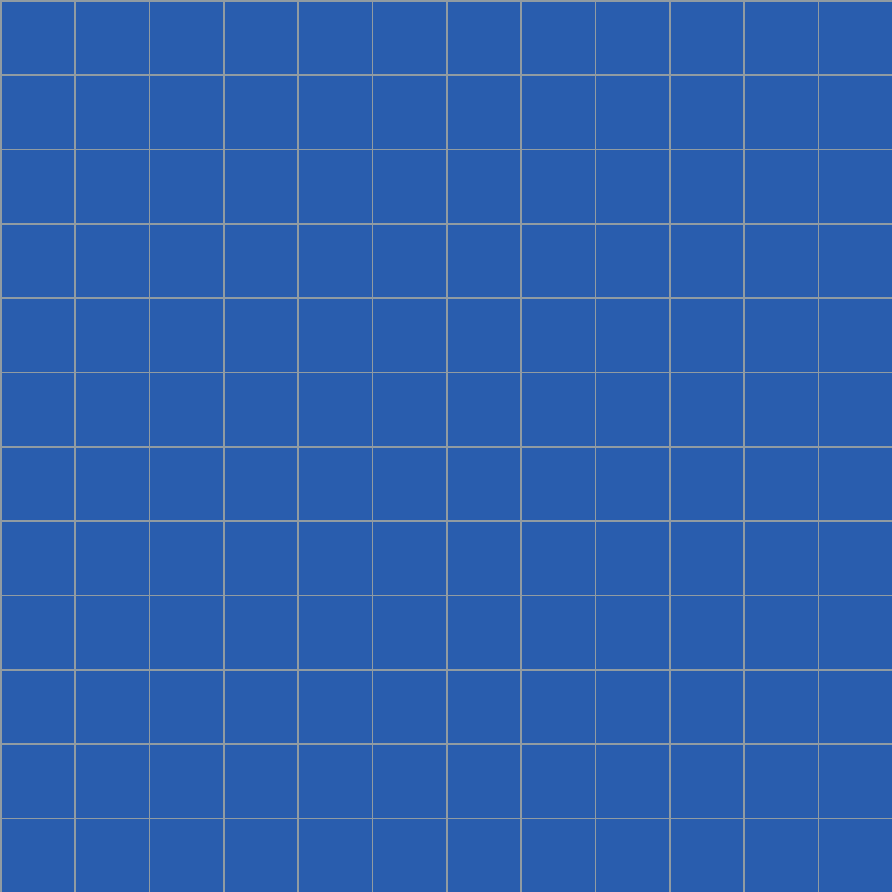

Dieser **Testbeitrag** zeigt jeden Baustein einmal. Alle Medien sind selbst erzeugte Platzhalter, alle Social-Media-Adressen sind Beispiele und führen ins Leere.

## Boxen

<Box typ="info" titel="Das Wichtigste in Kürze">
Eine **Info-Box** hebt etwas hervor, das Leserinnen und Leser nicht verpassen sollen. Sie darf Links, Listen und Hervorhebungen enthalten, zum Beispiel einen [Link](https://example.org).

- Erster Punkt
- Zweiter Punkt
</Box>

<Box typ="kontext" titel="Hintergrund">
Eine **Kontext-Box** liefert Hintergrund, der den Lesefluss nicht unterbrechen soll. Sie ist dezenter als die Info-Box.
</Box>

<Box typ="info">
Eine Box ohne Titel funktioniert auch.
</Box>

## Bild mit Legende und Quelle

<Bild
	src="test-bausteine/platzhalter-quer.png"
	alt="Petrolfarbene Fläche mit weissem Raster und einem hellen Rechteck in der Mitte"
	legende="Platzhalterbild im Querformat, selbst erzeugt."
	quelle="Eigene Grafik"
/>

Normale Markdown-Bilder gehen auch, ohne Legende:

## Video

<Video
	src="/videos/test-bausteine/demo.mp4"
	poster="/videos/test-bausteine/demo.jpg"
	legende="Zwei Sekunden Testbild, kein Ton."
	quelle="Eigenes Testvideo (ffmpeg)"
/>

## Instagram (Beispiel-Adresse)

<Instagram
	url="https://www.instagram.com/p/BEISPIEL-NUR-ZUM-TESTEN/"
	titel="Beispiel: Instagram-Beitrag"
	text="Platzhaltertext für die Vorschaukarte. Der Beitrag existiert nicht."
	bild="test-bausteine/vorschau-quadrat.png"
/>

## LinkedIn (Beispiel-Adresse)

<LinkedIn
	url="https://www.linkedin.com/posts/beispiel-person_nur-zum-testen-activity-7000000000000000000-ABCD"
	titel="Beispiel: LinkedIn-Beitrag"
	text="Platzhaltertext. Die Adresse ist erfunden."
/>

## YouTube (Beispiel-ID)

<YouTube id="BEISPIEL-ID1" titel="Beispiel: YouTube-Video" />

Zum Schluss ein normaler Absatz, damit man den Abstand nach dem letzten Baustein sieht.
